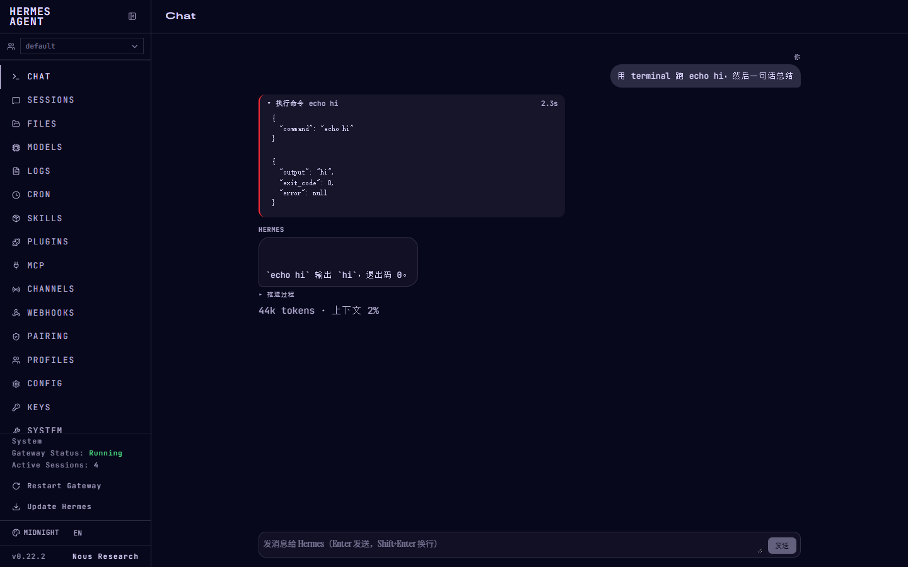

# hermes-bubbles

Hermes 网页仪表盘（`hermes dashboard`）的气泡聊天页。

内置的 `/chat` 是一个 xterm.js 终端，接 `/api/pty` 跑真的 TUI，所以它天生是终端长相：字符流、等宽字体、没有消息边界。这个插件把 `/chat` 换成原生气泡消息流——助手回答、工具调用、审批卡片各自成块，流式输出直接长在当前气泡里。

数据不走 PTY，走仪表盘自带的 `tui_gateway` JSON-RPC WebSocket（`/api/ws`），也就是桌面端用的那条。所以拿到的是结构化事件：`message.delta` 是一个 token 块，`tool.start` / `tool.complete` 是一对可配对的调用，`approval` 是要用户回答的请求。



## 快速开始

```bash
npm install --include=dev      # Windows 上 NODE_ENV=production 会静默跳过 devDependencies
npm test                       # 109 项，纯逻辑，不起浏览器
npm run install-plugin         # 构建 + 装进 $HERMES_HOME/plugins/hermes-bubbles/dashboard/
```

装完打开 `http://127.0.0.1:9119/chat`。仪表盘不用重启，但插件是**用户插件**，得先在 `config.yaml` 的 `plugins.enabled` 里登记：

```bash
hermes config set plugins.enabled '["homeassistant","hermes-bubbles"]'
curl -H "X-Hermes-Session-Token: <token>" http://127.0.0.1:9119/api/dashboard/plugins/rescan
```

（`<token>` 从仪表盘页面源码里的 `window.__HERMES_SESSION_TOKEN__` 取。）

## 能力

| 能力 | 状态 | 说明 |
|---|---|---|
| 流式气泡 | 已交付 | `message.delta` 逐块追加到当前气泡，末尾带闪烁光标 |
| 工具卡片 | 已交付 | 按 `tool_id` 配对 start/complete，运行中展开、完成后折叠，左侧状态色条 |
| 推理折叠 | 已交付 | `reasoning.delta` 收进气泡下方的可展开区 |
| 历史恢复 | 已交付 | `session.history` 投影成同样的气泡结构，刷新后不丢 |
| 审批卡片 | 已交付 | `approval` 服务端请求渲染成允许/拒绝按钮，直接回帧 |
| clarify 卡片 | 已交付 | 同上，按 `qid` 回答案 |
| 多轮续聊 | 已交付 | 一个会话内连续发消息；`session.create` 一次，之后复用 runtime id |
| 停止 | 已交付 | `session.interrupt`，失败也会本地封口气泡 |
| 会话列表 / 切换 | 未开工 | 现在每次打开 `/chat` 都是新会话 |
| 附件 / 粘贴图片 | 未开工 | 需要 `file.attach` + 上传 |
| 中途 steer | 未开工 | `session.steer` 已有契约，未接 UI |

## 架构

```
src/
├── core/          纯逻辑，无 DOM 无 socket，全部可单测
│   ├── types.ts       时间线模型（气泡 / 工具卡 / 提示）
│   ├── reduce.ts      事件 → 时间线
│   ├── history.ts     历史行 → 时间线
│   └── dedupe.ts      跨 socket 重复投递闸门
├── gateway/       传输
│   ├── channel.ts     JSON-RPC 通道（请求 / 事件 / 服务端请求）
│   └── client.ts      socket 生命周期 + 重连退避
├── app/
│   └── controller.ts  会话控制：过滤、去重、乐观气泡、重连补拉
├── ui/            渲染
│   ├── ChatPage.ts    页面骨架
│   ├── Bubble.ts    三种消息块
│   ├── format.ts      纯展示逻辑（工具名、截断、耗时）
│   └── style.css      变量驱动的少量样式
└── index.ts       注册入口
```

`core/` 和 `ui/format.ts` 里不许出现 `window` / `document` / `WebSocket`，这是能对着一堆边界情况写单测的前提。传输层通过构造参数注入 socket 工厂，测试用假 socket 驱动整条链路。

契约文档：`docs/01-protocol-contract.md`。协议是 Hermes 的内部实现，没有 OpenAPI 描述，所以那份文档记了核对基线（hermes-agent `0.22.2`，commit `d923a5eb487`）和一份升级后重跑的核对清单。

## 命令

| 想做什么 | 命令 |
|---|---|
| 单测 | `npm test` |
| 类型检查 | `npm run typecheck` |
| 构建 | `npm run build` |
| 构建 + 安装 | `npm run install-plugin` |
| 对着真仪表盘验收 | `node scripts/verify.mjs`（需要仪表盘在 9119 上跑着） |
| 看某次会话的 DOM | `node scripts/probe-turn.mjs` |

## 验证

- `npm test` — 109 项，覆盖归约、历史投影、去重闸门、JSON-RPC 通道（含心跳与服务端请求应答）、控制器（含重连与重同步）。
- `node scripts/verify.mjs` — 13 项，对**真实仪表盘**跑：插件接管 `/chat`、内置 xterm 消失、主题变量生效、后端能力探针通过、发一条消息后用户气泡出现、助手回答以气泡形式回来、控制台无报错。跑的是真模型真往返。

验收截图由该脚本产出，落在 `.cache/shots/`。

## 兼容性

| 项 | 实测值 |
|---|---|
| hermes-agent | 0.22.2（commit `d923a5eb487`） |
| 后端声明的方法 / 事件 | 257 / 77 |
| 插件 SDK 契约版本 | 1.1.0 |
| 需要的 RPC | `session.create` `session.resume` `session.list` `session.history` `prompt.submit` `session.interrupt` |
| 需要的事件 | `message.start` `message.delta` `message.interim` `message.complete` `reasoning.delta` `tool.start` `tool.complete` `status.update` `session.usage` `session.title` `session.info` `notice` `error` |
| 需要的服务端请求 | `approval` `clarify` |
| Node | 24.21.0 |
| 打包产物 | 53.5 KiB（不含 React） |

插件的后端路由 `/api/plugins/hermes-bubbles/capabilities` 会在页面渲染前问一次后端「这些方法/事件还在不在」，缺任何一条就报出缺的名字。协议漂移时它会先坏在明处，而不是渲染出一个空对话。

## 已知限制

- **用户插件要手动登记。** 仪表盘只加载 `plugins.enabled` 里的用户插件，装完不登记就只是被发现、不加载。内置插件没这个门槛。
- **服务端请求只接了 approval 和 clarify。** `vault.unlock_prompt`、`sudo`、`secret` 这些一律回 `-32601`，后端会快速失败而不是等满超时——这是有意的，但意味着这些流程在这个页面上走不通。
- **没有会话列表。** 打开页面就是新会话；历史恢复指的是同一会话刷新后不丢，不是能在会话之间切。
- **`useSyncExternalStore` 不在 SDK 的 hooks 白名单里**，得从 `SDK.React` 上取。SDK 的 `hooks` 是个精选子集，不是 React 全量。
- **协议无版本保证。** 这套 JSON-RPC 是内部实现，`hermes update` 后可能漂移；`capabilities` 路由是第一道闸，`docs/01-protocol-contract.md` 的核对清单是第二道。
- 工具结果里只有 `write_file` / `patch` / `skill_manage` 三个带原始 `content`（后端投影如此），其余工具的历史行只有一行摘要，展开也看不到完整输出。

## 许可

MIT
