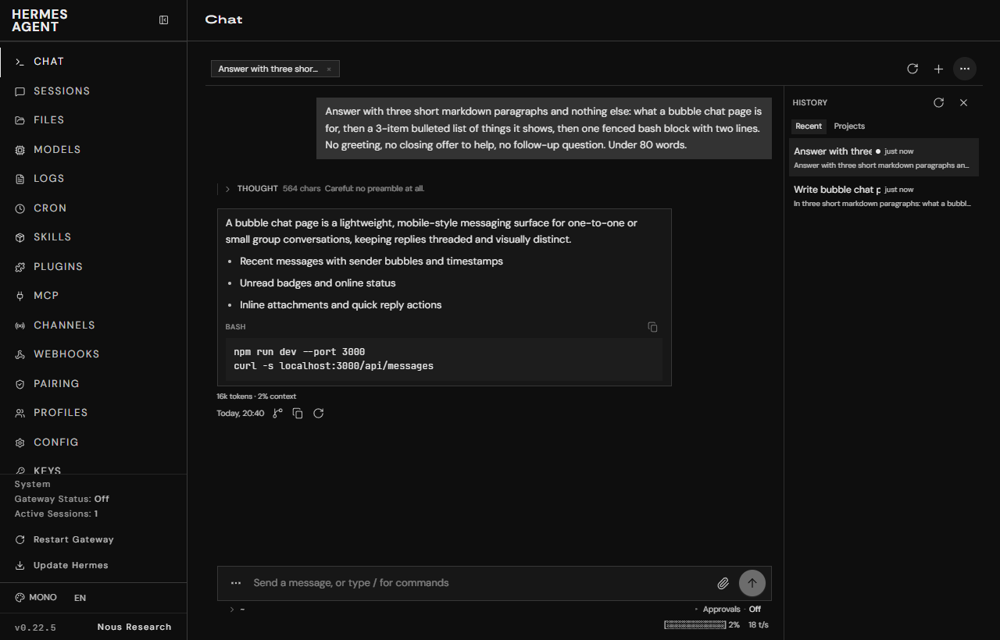
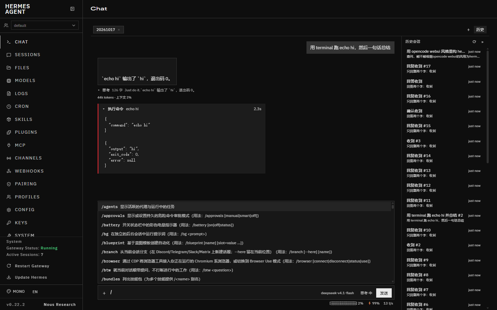

# hermes-bubbles

> English (default): [README.md](README.md)

Hermes 网页仪表盘（`hermes dashboard`）的气泡聊天页。

内置的 `/chat` 是一个 xterm.js 终端，接 `/api/pty` 跑真的 TUI，所以它天生是终端长相：字符流、等宽字体、没有消息边界。这个插件把 `/chat` 换成原生气泡消息流——助手回答、工具调用、审批卡片各自成块，流式输出直接长在当前气泡里。

数据不走 PTY，走仪表盘自带的 `tui_gateway` JSON-RPC WebSocket（`/api/ws`），也就是桌面端用的那条。所以拿到的是结构化事件：`message.delta` 是一个 token 块，`tool.start` / `tool.complete` 是一对可配对的调用，`approval` 是要用户回答的请求。



打开的会话是顶部一排页签，历史会话在右侧面板（可收起，每行带一个「已打开 / 运行中」状态灯），中间是转写区：气泡、工具卡片、半显式可展开的思考过程，右缘一条定位轨道可跳回之前的消息；底部输入框带附件、模型、思考强度与实时指标。



## 快速开始

插件是仪表盘的**目录型插件**，不是 npm 包。两条路：

**从仓库克隆**（要改源码、跑测试时用这条）：

```bash
git clone https://github.com/NaimioChan/hermes-bubbles
cd hermes-bubbles
npm install --include=dev      # Windows 上 NODE_ENV=production 会静默跳过 devDependencies
npm test                       # 397 项，纯逻辑，不起浏览器
npm run install-plugin         # 构建 + 装进 $HERMES_HOME/plugins/hermes-bubbles/dashboard/
hermes plugins enable hermes-bubbles
```

**用 Hermes 自己的安装命令**（不需要 Node，构建产物已入库）：

```bash
hermes plugins install https://github.com/NaimioChan/hermes-bubbles
hermes plugins enable hermes-bubbles
```

两条路都得让插件进 `plugins.enabled`（`hermes plugins enable` 会替你写）；手动登记的话：

```bash
hermes config set plugins.enabled '["hermes-bubbles"]'
curl -H "X-Hermes-Session-Token: <token>" http://127.0.0.1:9119/api/dashboard/plugins/rescan
```

（`<token>` 从仪表盘页面源码里的 `window.__HERMES_SESSION_TOKEN__` 取。）

装完打开 `http://127.0.0.1:9119/chat`，仪表盘不用重启。

构建产物放在 `dashboard/dist/` 并**入库**：仪表盘扫描器只认 `<plugins root>/<name>/dashboard/manifest.json`，而按 SHA 检出的安装不会跑构建。改了源码之后 `npm run install-plugin` 会同时重写仓库里那份和已安装那份，两边不会漂移。

## 能力

| 能力 | 状态 | 说明 |
|---|---|---|
| 流式气泡 | 已交付 | `message.delta` 逐块追加到当前气泡，末尾带闪烁光标 |
| 工具卡片 | 已交付 | 按 `tool_id` 配对 start/complete，运行中展开、完成后折叠，左侧状态色条 |
| 历史恢复 | 已交付 | `session.history` 投影成同样的气泡结构，刷新后不丢 |
| 审批卡片 | 已交付 | `approval` 服务端请求渲染成允许/拒绝按钮，直接回帧 |
| clarify 卡片 | 已交付 | 同上，按 `qid` 回答案 |
| 多轮续聊 | 已交付 | 一个会话内连续发消息；`session.create` 一次，之后复用 runtime id |
| 停止 | 已交付 | `session.interrupt`，失败也会本地封口气泡 |
| Markdown 回复 | 已交付 | 助手气泡按 markdown 渲染：标题、粗斜体、删除线、行内码、围栏代码块（带语言标签）、有序/无序列表（可嵌套）、引用、分隔线、表格（带对齐）；流式过程中遇到未闭合的围栏或标记不会崩，按半成品渲染 |
| 斜杠命令 | 已交付 | `/` 唤起菜单，目录一次拉全后本地过滤（不截断）；`command.dispatch` 的六种指令都接了 |
| 会话列表与切换 | 已交付 | 侧栏两段：打开中的 tab 与历史会话，可新建、切换、关闭、重开 |
| 多开会话 | 已交付 | 一条 socket 承载多个会话，事件按 `session_id` 分流，每个 tab 独立时间线 |
| 附件 | 已交付 | `+` 按钮与拖放/粘贴；按类型走 `image.attach_bytes` / `pdf.attach` / `file.attach` |
| 模型选择 | 已交付 | `model.options` 列表 + `config.set`；会话级切换，贵的模型会回报确认要求 |
| 思考强度 | 已交付 | 七档 `config.set key=reasoning scope=session` |
| 思考过程半显式 | 已交付 | 流式时显示最后一行 + 光标，结束后收成一行摘要，可展开全文 |
| 实时指标 | 已交付 | 上下文条 + 占用百分比、缓存命中率、输出速度、花费，随 `session.usage` 更新 |
| 会话保持 | 已交付 | 切到 dashboard 其他页面再回到 chat，打开的页签与进行中的回复都还在（controller 跨路由存活，不再随卸载销毁） |
| 定位器 | 已交付 | 聊天区右侧一条窄轨道，每条你自己发的消息一个刻度；悬停显示开头几个字，点击滚到那条消息 |
| 空状态可输入 | 已交付 | 关掉所有页签后输入框仍可用，发送会自动新建会话 |
| 会话管理 | 已交付 | 历史面板每行可重命名、删除，并带一个状态灯：亮起＝该会话已在页签中打开，闪烁＝正在运行（走 REST `PATCH` / `DELETE /api/sessions/{id}`，与桌面端一致）；删除后会回查确认，不信任 REST 的 `ok` |
| 编辑已发送消息 | 已交付 | 用户气泡上悬停出现编辑；改完发送会从该轮重写（`prompt.submit` + `truncate_before_row_id` + `confirm_truncate`），后续内容一并截断 |
| 消息操作 | 已交付 | 回复气泡右下角：时间戳、在新对话中分支、复制、重新生成（朗读与回应表情按你的要求不做），对齐桌面端 |
| 审批 / 选择题 | 已交付 | `approval` 与 `clarify` 两张卡；选择项取自服务端下发的 `choices`（不再自己写死），`multi_select` 合并成字符串提交，未答完不可提交 |
| 界面语言 | 已交付 | 默认英语；跟随仪表盘的语言切换自动改变，无需刷新 |
| 中途 steer | 已交付 | 运行中仍可发送；后端按 `prompt.submit` 的 busy 路径决定排队 / 插入 / 改向，页面把结果显示成一行提示 |

## 架构

```
src/
├── core/          纯逻辑，无 DOM 无 socket，全部可单测
│   ├── types.ts       时间线模型（气泡 / 工具卡 / 提示 / 用量）
│   ├── reduce.ts      事件 → 时间线
│   ├── history.ts     历史行 → 时间线
│   ├── sessions.ts    多会话 store：tab、事件分流、历史替换、编辑定位
│   ├── markdown.ts    Markdown → 节点树（从不产出 HTML）
│   ├── rail.ts        定位轨道的几何计算
│   ├── requests.ts    approval / clarify 的解析与应答整形
│   ├── slash.ts       斜杠 token / 补全 / dispatch 解析
│   ├── attachments.ts 附件队列、体积与类型筛查
│   ├── metrics.ts     用量指标格式化与压力分级
│   ├── i18n.ts        文案目录与时间戳格式化
│   └── dedupe.ts      跨 socket 重复投递闸门
├── gateway/       传输
│   ├── channel.ts     JSON-RPC 通道（请求 / 事件 / 服务端请求）
│   └── client.ts      socket 生命周期 + 重连退避 + ensureOpen
├── app/
│   ├── controller.ts  会话控制：RPC 网关、路由、模型切换、附件、重同步
│   └── persistent.ts  controller 跨路由存活
├── ui/            渲染
│   ├── ChatPage.ts    页面骨架与状态接线
│   ├── TabStrip.ts    顶部页签（打开中的会话）
│   ├── HistoryPanel.ts 历史会话、改名/删除、状态灯
│   ├── Composer.ts    输入框、斜杠菜单、附件托盘、指标条
│   ├── Bubble.ts      消息块与可展开的思考过程
│   ├── Markdown.ts    用 React.createElement 渲染节点树
│   ├── LocatorRail.ts 定位轨道
│   ├── RequestCards.ts 审批卡与选择题卡
│   ├── ModelPicker.ts 模型与思考强度选择器
│   ├── format.ts      纯展示逻辑（工具名、截断、耗时）
│   └── style.css      变量驱动的手写样式
└── index.ts       注册入口
```

`core/` 和 `ui/format.ts` 里不许出现 `window` / `document` / `WebSocket`，这是能对着一堆边界情况写单测的前提。传输层通过构造参数注入 socket 工厂，测试用假 socket 驱动整条链路。

契约文档：`docs/01-protocol-contract.md`。协议是 Hermes 的内部实现，没有 OpenAPI 描述，所以那份文档记了核对基线（hermes-agent `0.22.2`，commit `d923a5eb487`）和一份升级后重跑的核对清单。

## 命令

| 想做什么 | 命令 |
|---|---|
| 单测 | `npm test` |
| 类型检查 | `npm run typecheck` |
| 构建 | `npm run build` |
| 构建 + 安装 | `npm run install-plugin` |
| 对着真仪表盘验收 | `node scripts/verify.mjs`（需要仪表盘在 9119 上跑着） |
| 看某次会话的 DOM | `node scripts/probe-turn.mjs` |

## 验证

- `npm test` — 397 项 / 19 个文件，覆盖归约、历史投影、多会话分流、Markdown 解析（含「对一条消息的每个前缀都不抛异常」的性质检查）、斜杠解析与补全、附件队列、用量指标、去重闸门、JSON-RPC 通道（含心跳与服务端请求应答）、控制器（多开、模型切换、附件、重连、编辑重发、会话读写）、定位轨道，以及**四条源码级守卫**：`hook-order`（钩子不得出现在提前 return 之后）、`layout-classes`（宿主 CSS 里没有的类会静默失效）、`theme-vars`（宿主从不定义 `--color-foreground` / `--color-background`）、`architecture`（`core/` 无 DOM、无 `innerHTML`）。
- `node scripts/verify.mjs` — 64 项，对**真实仪表盘**跑真模型真往返：插件接管 `/chat`、内置 xterm 消失、流式气泡、Markdown 结构与配色实测、页签与历史面板布局、改名/删除落库、切页后页签保持、状态灯、定位轨道、空状态可输入等等。跑不了的项（模型这次没输出代码块）标 `SKIP` 而不是空转通过。

- `node scripts/verify-clarify.mjs` — 审批/选择题卡片的按需检查，单独放：它依赖模型主动调用 `clarify`，进主验收会随机失败。

验收截图由该脚本产出，落在 `.cache/shots/`。

## 兼容性

| 项 | 实测值 |
|---|---|
| hermes-agent | 0.22.2（commit `d923a5eb487`） |
| 后端声明的方法 / 事件 | 257 / 77 |
| 插件 SDK 契约版本 | 1.1.0 |
| 需要的 RPC | `session.create` `session.resume` `session.list` `session.history` `session.close` `prompt.submit` `session.interrupt` `session.undo` `session.branch` |
| 需要的 REST | `PATCH` / `DELETE /api/sessions/{id}`（改名、删除） |
| 需要的事件 | `message.start` `message.delta` `message.interim` `message.complete` `reasoning.delta` `tool.start` `tool.complete` `status.update` `session.usage` `session.title` `session.info` `notice` `error` |
| 需要的服务端请求 | `approval` `clarify` |
| Node | 24.21.0 |
| 打包产物 | ~180 KiB（不含 React） |

插件的后端路由 `/api/plugins/hermes-bubbles/capabilities` 会在页面渲染前问一次后端「这些方法/事件还在不在」，缺任何一条就报出缺的名字。协议漂移时它会先坏在明处，而不是渲染出一个空对话。

## 界面语言

默认英语（Hermes 自身 `display.language` 的默认值就是 `en`），并跟随仪表盘切换：插件读 `localStorage['hermes-locale']` 与 `<html lang>` 两个信号，监听 `storage` 事件与 `<html lang>` 的变化，所以在仪表盘里换语言即刻生效、不用刷新。文案集中在 `src/core/i18n.ts`，目前中英两套。

（`SDK.useI18n` 在插件里拿不到值——它只是对宿主某个 context 的 `useContext`，而那个 context 插件 import 不到，只会永远返回 provider 的默认值，且切换后不更新。所以自带一份小目录。）

## 回复的 Markdown

助手气泡的文本走自带的解析器，没有第三方依赖，也不拼 HTML 字符串：

- `src/core/markdown.ts` — 纯函数，字符串进、节点树出，无 DOM，可单测（48 条）。
- `src/ui/Markdown.ts` — 把节点树用 `React.createElement` 渲染出来。全流程没有 `innerHTML`，文本由 React 转义，注入这一类问题不存在而不是被净化掉。链接仍过 `safeHref()`，只放行 `http/https/mailto/tel` 与相对路径。

刻意不支持 setext 标题（`标题` 下面一行 `---`）——模型都写 `##`，而把裸 `---` 当标题惹的麻烦多得多，它按分隔线处理（和 CommonMark 一致）。

行内代码、代码块都跟随气泡前景色（行内代码对比度实测 8.72:1）。时间戳按毫秒渲染，本地时区。代码块右上角有复制按钮，剪贴板不可用时退回 `execCommand`。

命令/工具卡片一律默认折叠，只显示一行摘要（类型、摘要、耗时），点开才看输出。审批与选择题的选项**每行一个、占满宽度**——之前用 `flex-wrap` 排，三个短选项会挤在同一行。这两点都需要显式覆盖宿主的全局 `code` 规则——它按标签名匹配，会给 `<pre>` 里的 `<code>` 套上内联代码的浅底黑字样式，既让块缩到文字宽度，又让文字看不清。

解析器要能跑**半句话**：每个流式增量都会重解整条消息，所以未闭合的围栏（按代码块渲染）、单独的 `**`、还没等到分隔行的表格都是正常输入。测试里有一条性质检查：对一条完整消息的**每个前缀**都跑一遍，不允许抛异常。

## 样式约束：只用宿主 CSS 里已有的类

插件渲染在仪表盘**预编译**好的 Tailwind 产物里，那份 CSS 只包含仪表盘自己源码用过的类。我们新造一个它没有的类，**不会报错、不会有警告，就是那条属性完全不生效**。这一条踩出过三个可见 bug：`resize-none`（输入框保留原生缩放手柄）、`max-h-[70vh]`（模型选择器没有高度上限）、`text-[0.625rem]`（用量行按 15px 基准渲染）。

所以：新样式一律写进 `src/ui/style.css`，作为显式的 `hb-` 类。

```bash
node scripts/audit-classes.mjs   # 列出所有「用了但宿主 CSS 里没有、也不会报错」的类
```

`tests/layout-classes.test.ts` 会守这条：`hb-` 类必须在自己的样式表里有定义，非 `hb-` 类必须在宿主 CSS 里存在（宿主没装时回退到一份实测过的白名单，保证新克隆也能跑）。

CSS 变量同理，而且失败方式更隐蔽：宿主**从不定义** `--color-foreground` 和 `--color-background`（0.22.2 实测，23 个 `--color-*` 里没有这两个）。`var(--undefined)` 不报错，整条声明在计算值阶段被丢掉，元素静默继承或者透出背景——`--color-background` 曾让代码块和审批卡变成全透明。`tests/theme-vars.test.ts` 逐个核对，离线回退白名单。

## 已知限制

- **用户插件要手动登记。** 仪表盘只加载 `plugins.enabled` 里的用户插件，装完不登记就只是被发现、不加载。内置插件没这个门槛。
- **服务端请求只接了 approval 和 clarify。** `vault.unlock_prompt`、`sudo`、`secret` 这些一律回 `-32601`，后端会快速失败而不是等满超时——这是有意的，但意味着这些流程在这个页面上走不通。
- **界面状态不跨整页刷新。** 打开的页签在仪表盘内切换页面时保留，但浏览器刷新会重置。
- **`useSyncExternalStore` 不在 SDK 的 hooks 白名单里**，得从 `SDK.React` 上取。SDK 的 `hooks` 是个精选子集，不是 React 全量。
- **协议无版本保证。** 这套 JSON-RPC 是内部实现，`hermes update` 后可能漂移；`capabilities` 路由是第一道闸，`docs/01-protocol-contract.md` 的核对清单是第二道。
- 工具结果里只有 `write_file` / `patch` / `skill_manage` 三个带原始 `content`（后端投影如此），其余工具的历史行只有一行摘要，展开也看不到完整输出。

## 许可

MIT
